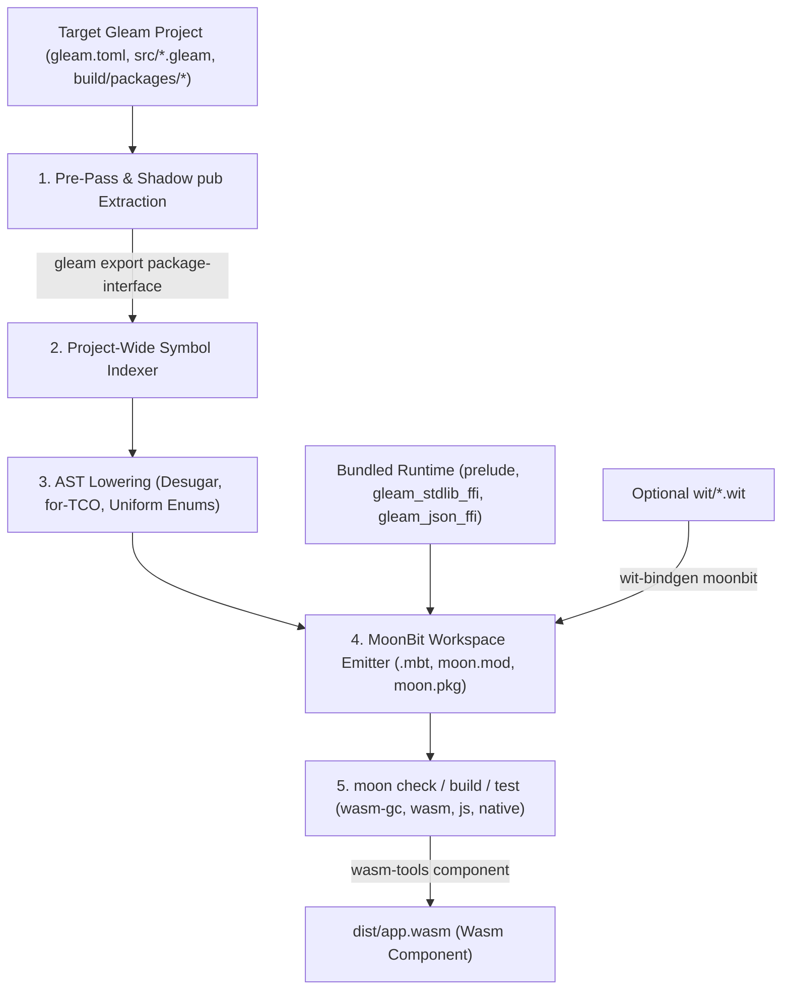

# `gekko` (月光)

**A Gleam-to-MoonBit transpiler and WebAssembly Component compiler.**

`gekko` (from Japanese *月光*, meaning *moonbeam*) compiles standard Gleam projects—including local modules and resolved Hex dependencies—into multi-package [MoonBit](https://www.moonbitlang.com/) workspaces. From there, MoonBit compiles your Gleam code to **`wasm-gc`**, **`wasm`** (linear memory), **`js`**, **`native`**, and **WebAssembly Components (WIT / WASI Preview 2)**.

---

## Why `gekko`?

- **Keep standard Gleam tooling:** Target projects stay 100% valid Gleam. `gleam check`, `gleam test`, and `gleam format` continue to work without modification.
- **Target WebAssembly & native via MoonBit:** Leverage MoonBit's compact, fast codegen across `wasm-gc`, linear `wasm`, JavaScript, and native binaries without maintaining a custom code generator or GC runtime.
- **Zero-boilerplate Wasm Component Model:** Generate WIT bindings via `wit-bindgen moonbit` and bundle WASI Preview 2 components with `wasm-tools`.
- **Automatic standard library & JSON support:** Transpile `gleam_stdlib` and `gleam_json` directly from Hex `build/packages/`, backed by native MoonBit FFI shims (`Map`, `@json.Json`, `Bytes`) while preserving exact Gleam semantics.

---

## Architecture Overview



### Core Design Highlights

1. **Shadow `pub` Type Resolution:** To satisfy MoonBit's requirement for explicit top-level function type annotations without re-implementing Hindley-Milner inference, `gekko` stages a shadow copy of source files with private declarations temporarily promoted to `pub`, invokes `gleam export package-interface`, and gets exact compiler-inferred signatures for every function. MoonBit handles local type inference inside function bodies.
2. **Uniform Enums & Uniform Getters:** Every Gleam custom type—single-variant or multi-variant—compiles to a MoonBit `pub(all) enum` with synthesized `.field()` getter methods, eliminating constructor/pattern syntax splits and receiver-type ambiguity at dot-access sites.
3. **Functional `for` Loop TCO:** Self-tail-recursive Gleam functions lower to MoonBit functional `for` state loops (`for a = a, b = b { ... => continue ... }`), guaranteeing $O(1)$ stack space across all MoonBit targets (`wasm-gc`, `wasm`, `js`, `native`).
4. **Persistent Lists (`GList[T]`):** Gleam `List(a)` maps to a persistent singly-linked `@prelude.GList[T]` (`Nil` / `Cons`) instead of MoonBit's mutable `Array[T]`, preserving $O(1)$ prepends and pattern deconstruction.
5. **FFI-Backed `gleam_stdlib` & `gleam_json`:** Instead of re-writing every pure-Gleam library function by hand, `gekko` transpiles the official `.gleam` sources from Hex and provides MoonBit FFI backing packages only for leaf `@external` primitives.

---

## CLI Usage

```bash
# Type-check transpiled MoonBit output for a Gleam project
gekko check [--target <wasm-gc|wasm|js|native>] [--root <dir>] [--out <dir>]

# Transpile and build targeting wasm-gc (default), wasm, js, or native
gekko build --target wasm-gc
gekko build --target wasm
gekko build --target js
gekko build --target native

# Run tests or execute `main()` through MoonBit
gekko test [--target <wasm-gc|wasm|js|native>] [--root <dir>]
gekko run  [--target <wasm-gc|wasm|js|native>] [--root <dir>]

# Generate Gleam FFI stubs + MoonBit adapter from a MoonBit package (.mbti)
gekko moonbit bind <pkg> [--root <dir>] [--module <gleam_mod>] [--out <dir>]

# Generate WIT bindings, type-check, and bundle a Wasm Component (WIT / WASI Preview 2)
gekko wit gen   [--root <dir>] [--wit <dir>] [--world <name>]
gekko wit check [--root <dir>] [--wit <dir>] [--world <name>] [--out <dir>]
gekko wit build [--root <dir>] [--wit <dir>] [--world <name>] [--output dist/app.wasm]
```

---

## MoonBit FFI, Types, Dependencies & Overrides

Target projects can interoperate with MoonBit code without breaking `gleam check`:

### 1. Local `moonbit/` Packages & `@external` / `@external_type` Pragmas

Place local MoonBit packages in `<project_root>/moonbit/<pkg>/`. When `moon.pkg` is omitted, `gekko` auto-generates one importing `<project_name>/gprelude`.

```gleam
/// @external_type(moonbit, "text_ffi", "Counter")
pub type Counter

/// @external(moonbit, "text_ffi", "read_counter")
pub fn read_counter(c: Counter) -> Int {
  let _ = c
  panic as "Implemented in MoonBit"
}
```

### 2. Automatic Binding Generation (`gekko moonbit bind`)

Generate Gleam stubs (`src/ffi/<pkg>.gleam`) and any needed MoonBit adapter (`moonbit/<pkg>_adapter/`) directly from a standard-library, local, or `moonbit/moon.mod` dependency package:

```bash
gekko moonbit bind moonbitlang/x/fs --root examples/file_io
```

### 3. Third-Party MoonBit Dependencies (`moonbit/moon.mod`)

Declare registry dependencies in `<project_root>/moonbit/moon.mod` using MoonBit's native manifest format (you can also manage it with `moon -C moonbit add <pkg>`):

```moonbit
// moonbit/moon.mod
name = "file_io"
version = "0.1.0"

import {
  "moonbitlang/x@0.5.7",
}
```

### 4. Raw `@external(moonbit, ...)` & Dependency Overrides

```gleam
@external(moonbit, "my_org/math", "fast_sqrt")
pub fn fast_sqrt(x: Float) -> Float
```

Or override functions in third-party Hex dependencies in `gleam.toml` (`[tools.gekko.overrides."..."]`) without modifying `build/packages/`:

```toml
# gleam.toml
[tools.gekko.overrides."simplifile.read"]
package = "wasi/filesystem"
function = "read_to_string"
```

---

## Examples

Each example includes its own `README.md` with setup, generation commands (where applicable), and run instructions:

| Example | What It Shows | Guide |
| --- | --- | --- |
| **Gleam Tour** | Pure Gleam language tour (basics, TCO loops, records, `echo`, stdlib) | [`examples/gleam_tour/README.md`](./examples/gleam_tour/README.md) |
| **Weather App** | `gleam/json` & `gleam/dynamic/decode` with custom records and pipelines | [`examples/weather_app/README.md`](./examples/weather_app/README.md) |
| **WIT Greeter** | Wasm Component (`wit/world.wit`, `gekko wit gen`, `wit check`, `wit build`) | [`examples/wit_greeter/README.md`](./examples/wit_greeter/README.md) |
| **MoonBit FFI** | Local `moonbit/` packages, `moonbitlang/core/math`, and `@external_type` | [`examples/moonbit_ffi/README.md`](./examples/moonbit_ffi/README.md) |
| **File I/O** | Reading/writing files via `moonbit/moon.mod` (`moonbitlang/x/fs`) + `gekko moonbit bind` | [`examples/file_io/README.md`](./examples/file_io/README.md) |

---

## Project Documentation

- **[`docs/SPEC.md`](./docs/SPEC.md)** — Full architectural specification, lowering rules, runtime design, and WIT bridge details.
- **[`docs/ROADMAP.md`](./docs/ROADMAP.md)** — Phased implementation plan, deliverables, and verification gates.
- **[`docs/GLEAM_SYNTAX_MAP.md`](./docs/GLEAM_SYNTAX_MAP.md)** — Complete mapping from `glance` AST nodes to MoonBit lowering rules.
- **[`LICENSE`](./LICENSE)** — MIT License.

## Known Limitations

- **BitArray (Tier 1 only):** `gprelude.BitArray` is currently backed by byte-aligned `Bytes` (`8`, `16`, `32`, `64`-bit integer and `32`/`64`-bit float segments). Non-byte-aligned bit-level packing and bit-level pattern matching are not yet supported (planned for Tier 2 in [ROADMAP.md](./docs/ROADMAP.md)).
- **Testing MoonBit FFI code:** `gleam test` runs on Erlang/JS and cannot execute `@external(moonbit, ...)` functions unless they also provide an Erlang/JS external or pure-Gleam fallback. Use `gekko test` to transpile and run tests on MoonBit targets.
- **Mutual tail recursion:** Self-recursive tail calls are lowered to MoonBit `for` loops, while mutually recursive functions are not yet tail-call optimized.
