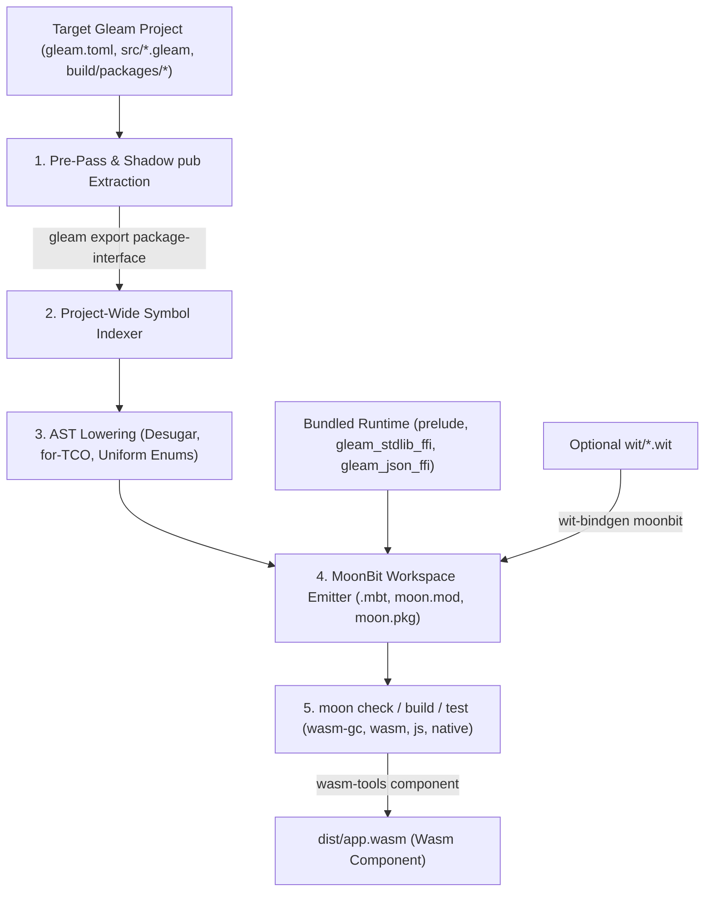

# `gekko` (月光)

**A Gleam-to-MoonBit transpiler and WebAssembly Component compiler.**

`gekko` (from Japanese *月光*, meaning *moonbeam*) compiles standard Gleam projects—including local modules and resolved Hex dependencies—into multi-package [MoonBit](https://www.moonbitlang.com/) workspaces. From there, MoonBit compiles your Gleam code to **`wasm-gc`**, **`wasm`** (linear memory), **`js`**, **`native`**, and **WebAssembly Components (WIT / WASI Preview 2)**.

---

## Why `gekko`?

- **Keep standard Gleam tooling:** Target projects stay 100% valid Gleam. `gleam check`, `gleam test`, and `gleam format` continue to work without modification.
- **Target WebAssembly & native via MoonBit:** Leverage MoonBit's compact, fast codegen across `wasm-gc`, linear `wasm`, JavaScript, and native binaries without maintaining a custom code generator or GC runtime.
- **Zero-boilerplate Wasm Component Model:** Generate WIT bindings via `wit-bindgen moonbit` and bundle WASI Preview 2 components with `wasm-tools`.
- **Automatic standard library & JSON support:** Transpile `gleam_stdlib` and `gleam_json` directly from Hex `build/packages/`, backed by native MoonBit FFI shims (`Map`, `@json.Json`, `Bytes`) while preserving exact Gleam semantics.

---

## Architecture Overview



### Core Design Highlights

1. **Shadow `pub` Type Resolution:** To satisfy MoonBit's requirement for explicit top-level function type annotations without re-implementing Hindley-Milner inference, `gekko` stages a shadow copy of source files with private declarations temporarily promoted to `pub`, invokes `gleam export package-interface`, and gets exact compiler-inferred signatures for every function. MoonBit handles local type inference inside function bodies.
2. **Uniform Enums & Uniform Getters:** Every Gleam custom type—single-variant or multi-variant—compiles to a MoonBit `pub(all) enum` with synthesized `.field()` getter methods, eliminating constructor/pattern syntax splits and receiver-type ambiguity at dot-access sites.
3. **Functional `for` Loop TCO:** Self-tail-recursive Gleam functions lower to MoonBit functional `for` state loops (`for a = a, b = b { ... => continue ... }`), guaranteeing $O(1)$ stack space across all MoonBit targets (`wasm-gc`, `wasm`, `js`, `native`).
4. **Persistent Lists (`GList[T]`):** Gleam `List(a)` maps to a persistent singly-linked `@prelude.GList[T]` (`Nil` / `Cons`) instead of MoonBit's mutable `Array[T]`, preserving $O(1)$ prepends and pattern deconstruction.
5. **FFI-Backed `gleam_stdlib` & `gleam_json`:** Instead of re-writing every pure-Gleam library function by hand, `gekko` transpiles the official `.gleam` sources from Hex and provides MoonBit FFI backing packages only for leaf `@external` primitives.

---

## CLI Usage

```bash
# Type-check transpiled MoonBit output for a Gleam project
gekko check

# Transpile and build targeting wasm-gc (default), wasm, js, or native
gekko build --target wasm-gc
gekko build --target wasm
gekko build --target js
gekko build --target native

# Run tests through the MoonBit test runner
gekko test
gekko test --target wasm-gc

# Build a Wasm Component (WIT / WASI Preview 2)
gekko build --wit ./wit --component dist/app.wasm
```

---

## MoonBit FFI & Overrides

Target projects can bind to MoonBit functions or raw Wasm imports in three ways without breaking `gleam check`:

### 1. Doc-Comment Pragma (100% compatible with `gleam check`)

```gleam
/// @external(moonbit, "my_org/wit_fs", "read_file")
pub fn read_file(path: String) -> Result(String, FileError) {
  Error(UnsupportedPlatform)
}
```

### 2. Raw `@external(moonbit, ...)` Attribute

```gleam
@external(moonbit, "my_org/math", "fast_sqrt")
pub fn fast_sqrt(x: Float) -> Float
```

`gekko`'s pre-pass extracts these mappings and strips the raw attribute in-memory before parsing with `glance`.

### 3. Sidecar Overrides (`gekko.toml` or `[tools.gekko.overrides]` in `gleam.toml`)

Override functions in third-party Hex dependencies without modifying `build/packages/`:

```toml
# gekko.toml
[overrides."simplifile.read"]
package = "wasi/filesystem"
function = "read_to_string"
```

---

## Project Documentation

- **[`docs/SPEC.md`](./docs/SPEC.md)** — Full architectural specification, lowering rules, runtime design, and WIT bridge details.
- **[`docs/ROADMAP.md`](./docs/ROADMAP.md)** — Phased implementation plan, deliverables, and verification gates.
- **[`docs/GLEAM_SYNTAX_MAP.md`](./docs/GLEAM_SYNTAX_MAP.md)** — Complete mapping from `glance` AST nodes to MoonBit lowering rules.
- **[`LICENSE`](./LICENSE)** — MIT License.
