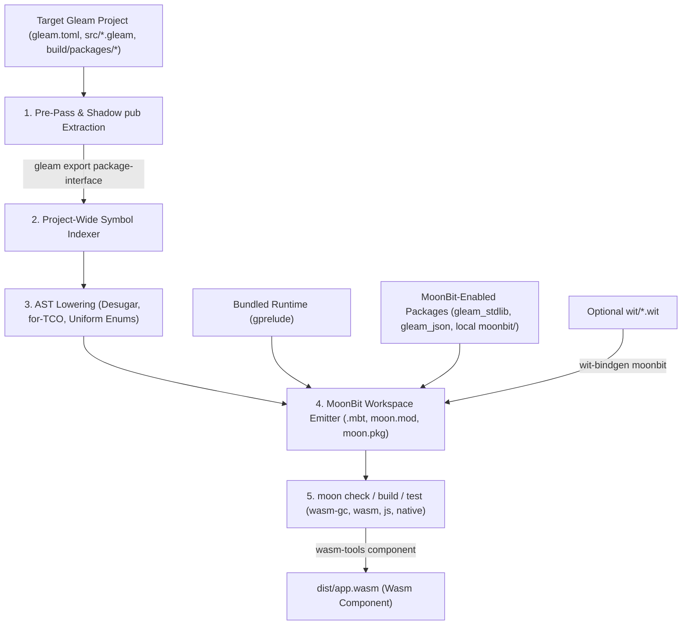

# `gekko` (月光)

**A Gleam-to-MoonBit transpiler and WebAssembly Component compiler.**

`gekko` (from Japanese *月光*, meaning *moonbeam*) compiles standard Gleam projects—including local modules and resolved Hex dependencies—into multi-package [MoonBit](https://www.moonbitlang.com/) workspaces. From there, MoonBit compiles your Gleam code to **`wasm-gc`**, **`wasm`** (linear memory), **`js`**, **`native`**, and **WebAssembly Components (WIT / WASI Preview 2)**.

---

## Why `gekko`?

- **Keep standard Gleam tooling:** Target projects stay 100% valid Gleam. `gleam check`, `gleam test`, and `gleam format` continue to work without modification.
- **Target WebAssembly & native via MoonBit:** Leverage MoonBit's compact, fast codegen across `wasm-gc`, linear `wasm`, JavaScript, and native binaries without maintaining a custom code generator or GC runtime.
- **Zero-boilerplate Wasm Component Model:** Generate WIT bindings via `wit-bindgen moonbit` and bundle WASI Preview 2 components with `wasm-tools`.
- **Standard library & JSON support:** Transpile MoonBit-enabled [`gleam_stdlib`](https://github.com/spiral-nights/gekko_gleam_stdlib) and [`gleam_json`](https://github.com/spiral-nights/gekko_gleam_json) forks (`/// @external(moonbit, ...)` + `moonbit/` FFI packages backed by `Map`, `@json.Json`, `Bytes`) with faithful Gleam semantics (see [`docs/SEMANTICS.md`](./docs/SEMANTICS.md) for documented differences).

---

## Architecture Overview



### Core Design Highlights

1. **Shadow `pub` Type Resolution:** To satisfy MoonBit's requirement for explicit top-level function type annotations without re-implementing Hindley-Milner inference, `gekko` stages a shadow copy of source files with private declarations temporarily promoted to `pub`, invokes `gleam export package-interface`, and gets exact compiler-inferred signatures for every function. MoonBit handles local type inference inside function bodies.
2. **Uniform Enums & Uniform Getters:** Every Gleam custom type—single-variant or multi-variant—compiles to a MoonBit `pub(all) enum` with synthesized `.field()` getter methods, eliminating constructor/pattern syntax splits and receiver-type ambiguity at dot-access sites.
3. **Functional `for` Loop TCO:** Self-tail-recursive Gleam functions lower to MoonBit functional `for` state loops (`for a = a, b = b { ... => continue ... }`), guaranteeing $O(1)$ stack space across all MoonBit targets (`wasm-gc`, `wasm`, `js`, `native`).
4. **Persistent Lists (`GList[T]`):** Gleam `List(a)` maps to a persistent singly-linked `@prelude.GList[T]` (`Nil` / `Cons`) instead of MoonBit's mutable `Array[T]`, preserving $O(1)$ prepends and pattern deconstruction.
5. **Self-Contained MoonBit Packages (`gleam_stdlib` & `gleam_json`):** Instead of hardcoding standard-library or JSON shims inside the compiler, `gekko` transpiles the MoonBit-enabled [`gleam_stdlib`](https://github.com/spiral-nights/gekko_gleam_stdlib) and [`gleam_json`](https://github.com/spiral-nights/gekko_gleam_json) forks directly, copying their bundled `moonbit/` FFI packages only for leaf `@external(moonbit, ...)` primitives.

---

## Installation

Prerequisites: [Gleam](https://gleam.run) (1.19.x) and Erlang/OTP on your `PATH`, plus [MoonBit](https://www.moonbitlang.com/) (`moon`) to build the generated output. `wasm-tools` and `wit-bindgen` are needed only for WebAssembly Component commands.

```bash
git clone https://github.com/spiral-nights/gekko && cd gekko
scripts/install.sh            # installs to ~/.local/bin/gekko
scripts/install.sh /some/bin  # or choose another directory (must be on PATH)
```

The script runs `gleam export erlang-shipment` and writes a small `gekko` launcher into the bin directory. The launcher runs the shipment in this repository's `build/erlang-shipment/`, so you can call `gekko` from any directory, and `--root`/`--out` resolve relative to your current directory. Re-run `scripts/install.sh` after pulling or changing gekko's source. Don't delete or move the repository, since the launcher points into it.

Without installing, you can still run `gleam run -- <command>` from the repository.

---

## Project Setup (`gleam.toml`)

Target projects should point `gleam_stdlib` (and `gleam_json`, if used) at the MoonBit-enabled forks in `gleam.toml`:

```toml
[dependencies]
gleam_stdlib = { git = "https://github.com/spiral-nights/gekko_gleam_stdlib.git", ref = "main" }
gleam_json = { git = "https://github.com/spiral-nights/gekko_gleam_json.git", ref = "main" }
```

Because the package names remain `gleam_stdlib` and `gleam_json`, any transitive Hex dependencies resolve automatically against these forks without version or module conflicts (as long as the fork version satisfies their SemVer constraint).

---

## CLI Usage

```bash
# Type-check transpiled MoonBit output for a Gleam project (--root defaults to `.`)
gekko check [--target <wasm-gc|wasm|js|native>] [--root <dir>] [--out <dir>]

# Transpile and build targeting wasm-gc (default), wasm, js, or native.
# Writes the compiled artifact (<name>.wasm / .js / .exe) into the current
# directory by default (or to --out / -o), keeping intermediates in build/moonbit.
gekko build [--target <wasm-gc|wasm|js|native>] [--root <dir>] [--out <file> | -o <file>]
gekko build --target wasm-gc
gekko build --target wasm
gekko build --target js
gekko build --target native --out myfile.exe

# Run tests or execute `main()` through MoonBit
gekko test [--target <wasm-gc|wasm|js|native>] [--root <dir>]
gekko run  [--target <wasm-gc|wasm|js|native>] [--root <dir>]

# Generate Gleam FFI stubs + MoonBit adapter from a MoonBit package (.mbti)
gekko moonbit bind <pkg> [--root <dir>] [--module <gleam_mod>] [--out <dir>]

# Generate WIT bindings, type-check, and bundle a Wasm Component (WIT / WASI Preview 2)
gekko wit gen   [--root <dir>] [--wit <dir>] [--world <name>]
gekko wit check [--root <dir>] [--wit <dir>] [--world <name>] [--out <dir>]
gekko wit build [--root <dir>] [--wit <dir>] [--world <name>] [--output dist/app.wasm]

# Show version or help
gekko --version
gekko --help
```

---

## MoonBit FFI, Types, Dependencies & Overrides

Target projects can interoperate with MoonBit code without breaking `gleam check`:

### 1. Local `moonbit/` Packages & `@external` / `@external_type` Pragmas

Place local MoonBit packages in `<project_root>/moonbit/<pkg>/`. When `moon.pkg` is omitted, `gekko` auto-generates one importing `<project_name>/gprelude`.

```gleam
/// @external_type(moonbit, "text_ffi", "Counter")
pub type Counter

/// @external(moonbit, "text_ffi", "read_counter")
pub fn read_counter(c: Counter) -> Int {
  let _ = c
  panic as "Implemented in MoonBit"
}
```

### 2. Automatic Binding Generation (`gekko moonbit bind`)

Generate Gleam stubs (`src/ffi/<pkg>.gleam`) and any needed MoonBit adapter (`moonbit/<pkg>_adapter/`) directly from a standard-library, local, or `moonbit/moon.mod` dependency package:

```bash
gekko moonbit bind moonbitlang/x/fs --root examples/file_io
```

### 3. Third-Party MoonBit Dependencies (`moonbit/moon.mod`)

Declare registry dependencies in `<project_root>/moonbit/moon.mod` using MoonBit's native manifest format (you can also manage it with `moon -C moonbit add <pkg>`):

```moonbit
// moonbit/moon.mod
name = "file_io"
version = "0.1.0"

import {
  "moonbitlang/x@0.5.7",
}
```

### 4. Raw `@external(moonbit, ...)` & Dependency Overrides

```gleam
@external(moonbit, "my_org/math", "fast_sqrt")
pub fn fast_sqrt(x: Float) -> Float
```

Or override functions in third-party Hex dependencies in `gleam.toml` (`[tools.gekko.overrides."..."]`) without modifying `build/packages/`:

```toml
# gleam.toml
[tools.gekko.overrides."simplifile.read"]
package = "wasi/filesystem"
function = "read_to_string"
```

---

## Supported Gleam Version

`gekko` targets **Gleam 1.19.x** (verified with `gleam 1.19.2`) and parses Gleam syntax via `glance >= 7.0.0 and < 8.0.0` / `glexer >= 2.5.0 and < 3.0.0`, delegating type-checking and package-interface extraction to the installed `gleam` compiler.

---

## Examples

Standalone example projects are hosted in [`gekko_examples`](https://github.com/spiral-nights/gekko_examples):

- **Gleam Tour** — Pure Gleam language tour (basics, TCO loops, records, `echo`, stdlib)
- **Weather App** — `gleam/json` & `gleam/dynamic/decode` with custom records and pipelines
- **WIT Greeter** — Wasm Component (`wit/world.wit`, `gekko wit gen`, `wit check`, `wit build`)
- **MoonBit FFI** — Local `moonbit/` packages, `moonbitlang/core/math`, and `@external_type`
- **File I/O** — Reading/writing files via `moonbit/moon.mod` (`moonbitlang/x/fs`) + `gekko moonbit bind`

---

## Project Documentation

- **[`docs/SPEC.md`](./docs/SPEC.md)** — Full architectural specification, lowering rules, runtime design, and WIT bridge details.
- **[`docs/SEMANTICS.md`](./docs/SEMANTICS.md)** — Runtime semantics, target behavior, and documented differences from Erlang/JS Gleam.
- **[`docs/ROADMAP.md`](./docs/ROADMAP.md)** — Phased implementation plan, deliverables, and verification gates.
- **[`docs/GLEAM_SYNTAX_MAP.md`](./docs/GLEAM_SYNTAX_MAP.md)** — Complete mapping from `glance` AST nodes to MoonBit lowering rules.
- **[`LICENSE`](./LICENSE)** — MIT License.

## Known Limitations

- **Fixed-width 64-bit `Int`s and runtime differences:** Gleam `Int` maps to signed 64-bit `Int64` with wrapping overflow rather than Erlang arbitrary-precision integers (or JS 53-bit safe integers). See [`docs/SEMANTICS.md`](./docs/SEMANTICS.md) for the full list of documented differences.
- **Testing MoonBit FFI code:** `gleam test` runs on Erlang/JS and cannot execute `@external(moonbit, ...)` functions unless they also provide an Erlang/JS external or pure-Gleam fallback. Use `gekko test` to transpile and run tests on MoonBit targets.
- **Mutual tail recursion:** Self-recursive tail calls are lowered to MoonBit `for` loops, while mutually recursive functions are not yet tail-call optimized.

## AI Usage

AI-assisted development tools are used in this project and are welcome for contributions. All code and documentation—whether human-written or AI-assisted—must pass the project's formatting and test checks (`gleam format --check src test` and `gleam test`) and be reviewed for correctness.
